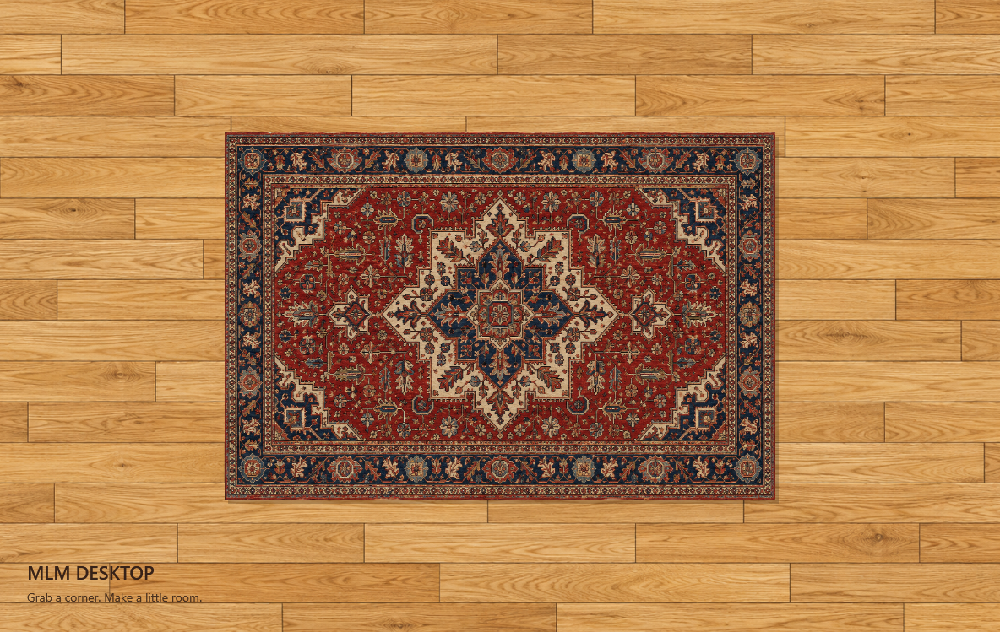
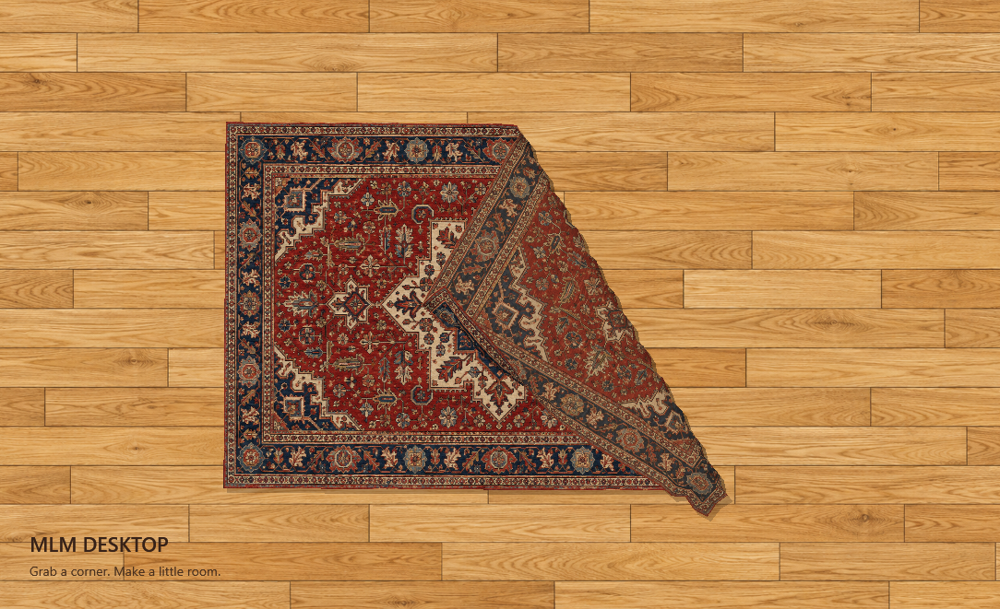

# MLM Desktop

A soft Persian rug over the **real Windows desktop**, controlled through a named Windows theme.



## نصب و استفاده

1. فایل **MLMDesktop-Setup-0.1.1.exe** را نصب کنید. تنظیمات **Personalization → Themes** باز می‌شود.
2. تم **MLM Desktop** را انتخاب کنید تا پارکت و قالیچه فعال شوند.
3. برای خاموش‌کردن قالیچه، تم دیگری انتخاب کنید. تغییر تصویر زمینه هم قالیچه را خاموش می‌کند.
4. وسط قالیچه را با موس بکشید تا جابه‌جا شود؛ لبه‌ها و گوشه‌ها را بکشید تا تا بخورند. **شیفت لازم نیست.** دوبار کلیک، قالیچه را صاف و وسط صفحه قرار می‌دهد.

هیچ میان‌بری در Start یا دسکتاپ و هیچ آیکونی در تسک‌بار یا کنار ساعت اضافه نمی‌شود. یک پردازش پس‌زمینه انتخاب تم را دنبال می‌کند. این پردازش با ورود به ویندوز اجرا می‌شود و اگر بسته شود یا اجرا نباشد، ظرف حداکثر یک دقیقه (با یک Scheduled Task مخفی و بدون نیاز به ادمین) خودکار برمی‌گردد؛ پس کافی است تم **MLM Desktop** را انتخاب کنید.

## Install

Download Setup from [Releases](https://github.com/mlmvpn/mlm-desktop/releases). Requires Windows 10/11 **x64** and **.NET Framework 4.8**. Per-user installation; no administrator rights required. The unsigned 0.1.1 release may show an unknown-publisher prompt. The app uses no network connection or account.

Setup installs the theme without applying it, starts the invisible theme watcher (kept alive by a per-user Run entry and a hidden per-user scheduled task that relaunches it within a minute if it is not running; no admin rights), and opens Windows Settings → Personalization → Themes. Select **MLM Desktop** to enable. Select another theme or change the background to disable. The rug follows the installed theme and its parquet image; it does not replace or restore wallpaper independently of Windows.

## Controls

| Action | Mouse control |
|---|---|
| Move the whole rug | Plain left-drag in its center |
| Lift and fold | Plain left-drag on any edge or corner |
| Flatten and center | Double-click |

Fold a corner, select native desktop icons with Ctrl-click or a selection rectangle on the uncovered desktop, move them onto the exposed floor, then pull the rug back over them. If icons snap back, turn off Desktop → View → Auto arrange icons. The app never moves, deletes, renames, or reads the icon files. Covering them is only visual.

Uninstall through Windows Settings → Apps. First select a different theme. If another theme or monitor still uses the parquet image, that image is retained to avoid breaking the wallpaper.

## Known limits

- Rug placement supports the **primary monitor**. Ordinary applications stay above the desktop overlay.
- Vertex/triangle cloth contacts preserve separation in the tested fold. Extreme fast or repeated folds may still intersect; full continuous cloth collision is not implemented.
- Fold and position reset on activation, restart, or display-size change.
- Windows 10, mixed-DPI monitors, desktop replacements, and full native-icon interaction still need broader acceptance testing.
- The ZIP contains developer app binaries; use **Setup** for theme registration and normal operation.



## Build

```powershell
.\build.ps1
```

Uses the .NET Framework C# compiler supplied with Windows. No NuGet or SDK download. Runs cloth and theme/interaction regression tests, then produces Setup and a binaries ZIP in `dist`.

```powershell
.\dist\app\MLMDesktop.exe --preview
.\dist\app\MLMDesktop.exe --preview --fold --snapshot "$PWD\fold.png"
.\dist\MLMDesktop-Setup-0.1.1.exe --extract "$PWD\test-extract"
```

See [validation notes](docs/VALIDATION.md). The developer preview window intentionally has a normal window frame; the installed desktop mode does not.

## Source layout

- `src/Cloth.cs`, `src/ClothContacts.cs`: fabric solver and layer separation.
- `src/App.cs`: WPF mesh, mouse input, invisible theme watcher.
- `src/Native.cs`: native desktop window positioning.
- `src/ThemeSelection.cs`, `src/DesktopMode.cs`: selected theme and wallpaper detection.
- `installer/`: per-user offline Setup, Windows theme, Apps uninstall.
- `assets/`: AI-generated textile and wood textures, code-drawn app icon. User screenshots are not included.
